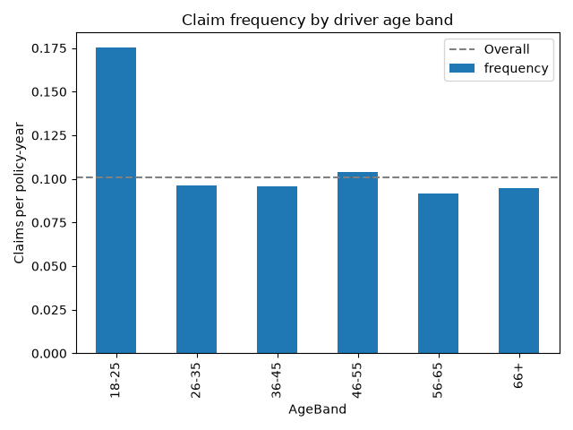
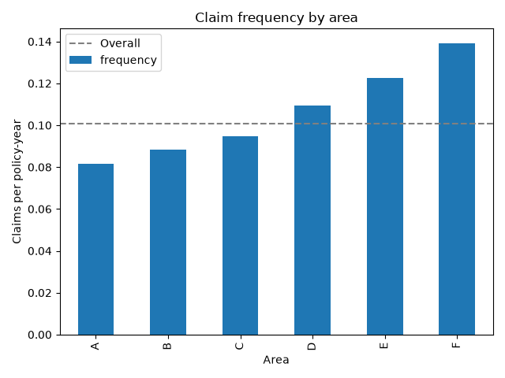
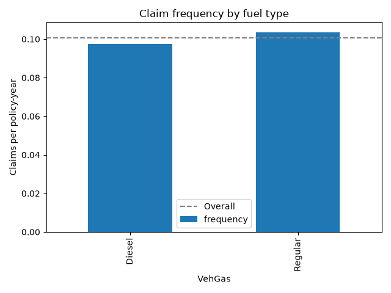

# Motor Claim Frequency Analysis

A small project looking at how often motor insurance claims happen across different groups of drivers. I built it to practise the basics of claims analysis in Python, as I'm interested in actuarial pricing.

## What I wanted to find out

How does claim frequency differ by driver age, fuel type and area in a French motor third-party liability portfolio?

## The data

I used the freMTPL2freq dataset, which is public and available through OpenML (ID 41214). It has 678,013 policies and 12 columns, with no missing values. The columns I used most were:

- `ClaimNb`: the number of claims on the policy
- `Exposure`: the fraction of a year the policy was in force
- `DrivAge`, `VehGas` and `Area`: the driver's age, the fuel type and the area code

## How I did it

Policies are covered for different lengths of time, so counting claims per policy would understate the risk for short policies. I measured claim frequency as total claims divided by total exposure, which gives claims per policy-year.

A few policies had more than one year of exposure (the maximum was 2.01), so I capped exposure at 1 year. I then grouped drivers into six age bands (18-25, 26-35, 36-45, 46-55, 56-65 and 66+) and calculated the frequency for each age band, fuel type and area. For each group I also worked out a relativity, which is the group's frequency divided by the overall frequency. A relativity of 1.20 means the group claims 20% more often than average.

I used Python with pandas for the calculations and matplotlib for the charts.

## What I found

Across the whole portfolio there were 36,102 claims over 358,360 policy-years, a frequency of **0.1007**, or roughly 10 claims per 100 policy-years.

| Factor | Highest | Lowest |
|---|---|---|
| Driver age | 18-25: 0.1751 (relativity 1.74) | 56-65: 0.0917 (relativity 0.91) |
| Area | F: 0.1392 (relativity 1.38) | A: 0.0817 (relativity 0.81) |
| Fuel type | Regular: 0.1036 (relativity 1.03) | Diesel: 0.0976 (relativity 0.97) |

Age made the biggest difference. Drivers aged 18-25 claimed about 1.9 times as often as drivers aged 56-65. Frequency also rose steadily from area A to area F, where F was about 1.7 times A. Fuel type had only a small effect, with about 6% between the two groups. I didn't see frequency rise again for older drivers, so the 66+ band looks much like the middle age bands.

## Limitations

This is a simple descriptive analysis, so it should be read with care:

- I looked at each factor on its own. Some of the differences probably overlap, for example if younger drivers are more common in certain areas, so the effect of each factor isn't separated out.
- The data covers claim counts only, not claim costs, so this isn't a full pricing analysis.
- The results show an association, not a cause.
- A few records have extreme values, such as one policy with 16 claims. I left them in rather than adjusting the data.

## Running it yourself

You'll need Python, then install the libraries with `pip install pandas matplotlib scikit-learn`. Open `claims_analysis.ipynb` and run the cells in order. The data downloads automatically from OpenML.

## Possible next steps

Adding the matching claim cost data to look at severity, and fitting a Poisson regression to measure the effect of each factor while accounting for the others.